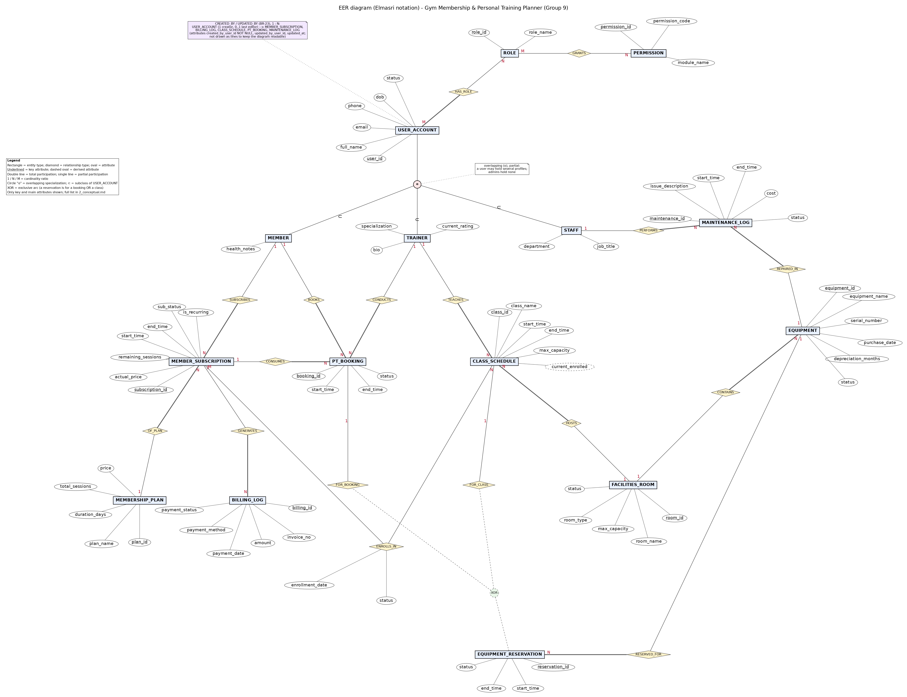
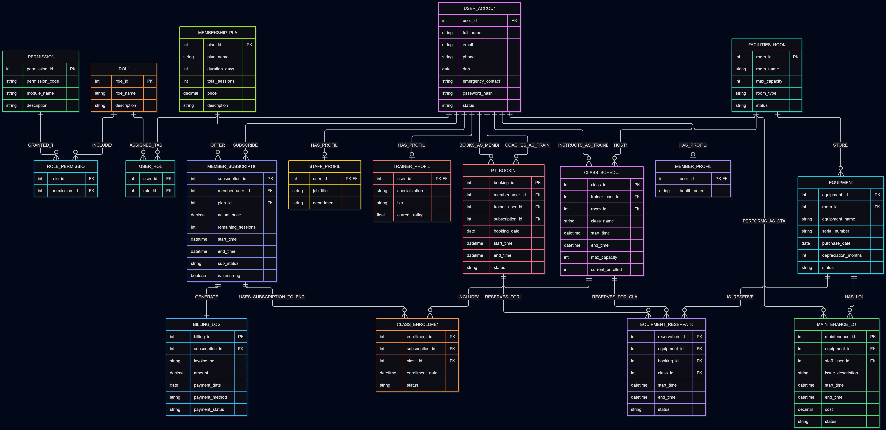
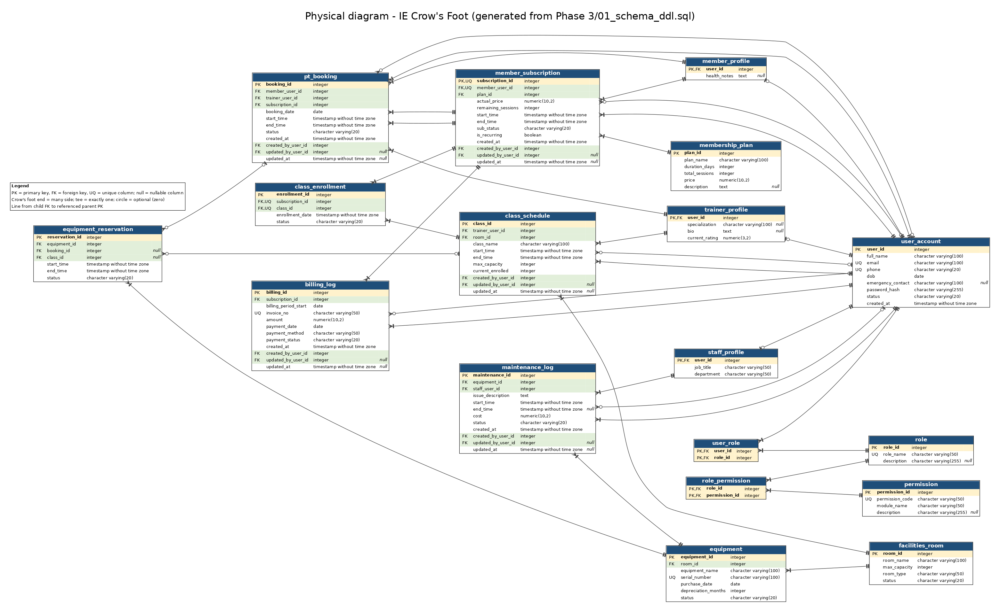

# 2.1. Mô hình Quan niệm – Sơ đồ ER/EER (Conceptual Model – ER/EER Diagram)

Mô hình quan niệm của hệ thống **Gym Membership & Personal Training Planner** được vẽ theo ký hiệu **Elmasri & Navathe (EER)**, độc lập với DBMS. Sơ đồ vật lý (IE Crow's Foot) ở mục 2.1.6 được sinh trực tiếp từ lược đồ thật `Phase 3/01_schema_ddl.sql`, bảo đảm khớp 100% với DDL.

## 2.1.1. Chú giải ký hiệu (Notation legend)

| Ký hiệu | Ý nghĩa |
|---|---|
| Hình chữ nhật | Kiểu thực thể (entity type) |
| Hình thoi | Kiểu quan hệ (relationship type) |
| Hình oval | Thuộc tính; <u>gạch chân</u> = thuộc tính khóa; oval nét đứt = thuộc tính dẫn xuất (derived) |
| Đường đơn / đường đôi | Tham gia riêng phần (partial) / tham gia toàn phần (total) |
| 1, N, M | Tỷ số lực lượng (cardinality ratio) |
| Vòng tròn `o` + ký hiệu ⊂ | Chuyên biệt hóa **chồng lấn (overlapping)**; ⊂ hướng về lớp con |
| Vòng tròn `XOR` nét đứt | Cung loại trừ (exclusive arc) |

## 2.1.2. Sơ đồ EER (Elmasri)



(Bản vector: [3_eer_diagram.svg](3_eer_diagram.svg); mã nguồn Graphviz: [3_eer_diagram.dot](3_eer_diagram.dot).)

> Sơ đồ cũ `1_mermaid-diagram.png` (ER dạng Mermaid) được **thay thế (superseded)** bởi sơ đồ EER và sơ đồ vật lý trong tài liệu này vì không thể hiện chuyên biệt hóa, tham gia toàn phần, cung loại trừ và các cột mới (`created_by_user_id`, `billing_period_start`). File cũ chỉ được giữ lại để báo cáo tham chiếu: 

## 2.1.3. Các kiểu thực thể (Entity types)

Gạch chân/(PK) là khóa; (D) là thuộc tính dẫn xuất.

### Phân hệ Phân quyền & Tài khoản (RBAC)
| Thực thể | Thuộc tính | Khóa |
|---|---|---|
| **USER_ACCOUNT** | user_id, full_name, email, phone, dob, emergency_contact, password_hash, status, created_at | PK `user_id`; khóa ứng viên `email`, `phone` |
| **ROLE** | role_id, role_name, description | PK `role_id`; `role_name` duy nhất |
| **PERMISSION** | permission_id, permission_code, module_name, description | PK `permission_id`; `permission_code` duy nhất |
| **MEMBER** (lớp con) | health_notes (+ kế thừa USER_ACCOUNT) | `user_id` kế thừa |
| **TRAINER** (lớp con) | specialization, bio, current_rating | `user_id` kế thừa |
| **STAFF** (lớp con) | job_title, department | `user_id` kế thừa |

### Phân hệ Gói tập & Thanh toán
| Thực thể | Thuộc tính | Khóa |
|---|---|---|
| **MEMBERSHIP_PLAN** | plan_id, plan_name, duration_days, total_sessions, price, description | PK `plan_id` |
| **MEMBER_SUBSCRIPTION** | subscription_id, actual_price, remaining_sessions, start_time, end_time, sub_status, is_recurring, created_at | PK `subscription_id` |
| **BILLING_LOG** | billing_id, invoice_no, billing_period_start, amount, payment_date, payment_method, payment_status, created_at | PK `billing_id`; `invoice_no` duy nhất |

### Phân hệ Lịch tập & Đặt chỗ
| Thực thể | Thuộc tính | Khóa |
|---|---|---|
| **CLASS_SCHEDULE** | class_id, class_name, start_time, end_time, max_capacity, **current_enrolled (D)** | PK `class_id` |
| **PT_BOOKING** | booking_id, booking_date, start_time, end_time, status, created_at | PK `booking_id` |

`current_enrolled` là thuộc tính **dẫn xuất** (= số ghi nhận CLASS_ENROLLMENT trạng thái `Enrolled`), được lưu vật lý và duy trì bằng trigger để chặn vượt sức chứa (BR liên quan `chk_class_enrollment_limit`).

### Phân hệ Cơ sở vật chất & Bảo trì
| Thực thể | Thuộc tính | Khóa |
|---|---|---|
| **FACILITIES_ROOM** | room_id, room_name, room_type, max_capacity, status | PK `room_id` |
| **EQUIPMENT** | equipment_id, equipment_name, serial_number, purchase_date, depreciation_months, status | PK `equipment_id`; `serial_number` duy nhất |
| **EQUIPMENT_RESERVATION** | reservation_id, start_time, end_time, status | PK `reservation_id` |
| **MAINTENANCE_LOG** | maintenance_id, issue_description, start_time, end_time, cost, status, created_at | PK `maintenance_id` |

## 2.1.4. Các kiểu quan hệ (Relationship types)

| Quan hệ | Thực thể tham gia | Tỷ số | Tham gia | BR nguồn |
|---|---|---|---|---|
| HAS_ROLE | USER_ACCOUNT – ROLE | M:N | USER_ACCOUNT: toàn phần (mọi tài khoản có ≥1 vai trò); ROLE: riêng phần | BR-22 |
| GRANTS | ROLE – PERMISSION | M:N | riêng phần cả hai | BR-22 |
| SUBSCRIBES | MEMBER – MEMBER_SUBSCRIPTION | 1:N | SUBSCRIPTION toàn phần; MEMBER riêng phần | Hội viên có thể có nhiều hợp đồng theo thời gian; tối đa 1 hợp đồng Active (index `uq_member_one_active_subscription`) |
| OF_PLAN | MEMBERSHIP_PLAN – MEMBER_SUBSCRIPTION | 1:N | SUBSCRIPTION toàn phần | Hợp đồng gắn đúng một gói |
| GENERATES | MEMBER_SUBSCRIPTION – BILLING_LOG | 1:N | BILLING_LOG toàn phần | BR-24 (hóa đơn gia hạn, bất biến) |
| BOOKS | MEMBER – PT_BOOKING | 1:N | PT_BOOKING toàn phần | BR đặt ca PT |
| CONDUCTS | TRAINER – PT_BOOKING | 1:N | PT_BOOKING toàn phần | BR chống trùng lịch PT (`ex_pt_trainer_no_overlap`) |
| CONSUMES | MEMBER_SUBSCRIPTION – PT_BOOKING | 1:N | PT_BOOKING toàn phần | BR-25 (trừ/hoàn buổi PT) |
| TEACHES | TRAINER – CLASS_SCHEDULE | 1:N | CLASS toàn phần | BR chống trùng lịch HLV (`ex_class_trainer_no_overlap`) |
| HOSTS | FACILITIES_ROOM – CLASS_SCHEDULE | 1:N | CLASS toàn phần | `ex_class_room_no_overlap` |
| ENROLLS_IN | MEMBER_SUBSCRIPTION – CLASS_SCHEDULE | M:N (thuộc tính: enrollment_date, status) | riêng phần | BR ghi danh lớp, sức chứa |
| CONTAINS | FACILITIES_ROOM – EQUIPMENT | 1:N | EQUIPMENT toàn phần | BR-26 |
| REPAIRED_IN | EQUIPMENT – MAINTENANCE_LOG | 1:N | MAINTENANCE_LOG toàn phần | BR-20 |
| PERFORMS | STAFF – MAINTENANCE_LOG | 1:N | MAINTENANCE_LOG toàn phần | BR-20 |
| RESERVED_FOR | EQUIPMENT – EQUIPMENT_RESERVATION | 1:N | RESERVATION toàn phần | BR-21 (`ex_reservation_equipment_no_overlap`) |
| FOR_BOOKING / FOR_CLASS | PT_BOOKING (hoặc CLASS_SCHEDULE) – EQUIPMENT_RESERVATION | 1:N, **loại trừ XOR** | riêng phần | BR-21, `chk_reservation_source` |
| CREATED_BY / UPDATED_BY | USER_ACCOUNT – {MEMBER_SUBSCRIPTION, BILLING_LOG, CLASS_SCHEDULE, PT_BOOKING, MAINTENANCE_LOG} | 1:N (mỗi quan hệ 2 khóa ngoại) | CREATED_BY toàn phần (`created_by_user_id` NOT NULL); UPDATED_BY riêng phần (`updated_by_user_id` cho phép NULL, kèm `updated_at`) | BR-23 |

Quan hệ CREATED_BY/UPDATED_BY (5 cặp quan hệ cùng mẫu) không vẽ thành đường trên sơ đồ EER để tránh rối; chúng được ghi trong hộp chú thích màu tím cạnh USER_ACCOUNT và thể hiện đầy đủ ở sơ đồ vật lý (10 khóa ngoại `fk_*_created_by` và `fk_*_updated_by`).

### Cung loại trừ (Exclusive arc) của EQUIPMENT_RESERVATION
Mỗi lượt giữ chỗ thiết bị thuộc về **đúng một** nguồn: hoặc một ca `PT_BOOKING` hoặc một `CLASS_SCHEDULE`, không bao giờ cả hai và không bao giờ không có nguồn nào. Mô hình hóa bằng hai khóa ngoại cùng nullable `booking_id`, `class_id` cùng ràng buộc `chk_reservation_source` (XOR). Trên sơ đồ, hai quan hệ FOR_BOOKING và FOR_CLASS nối vào vòng tròn XOR rồi vào EQUIPMENT_RESERVATION.

## 2.1.5. Chuyên biệt hóa USER_ACCOUNT → MEMBER / TRAINER / STAFF

- **Ràng buộc: chồng lấn (overlapping), riêng phần (partial)** — ký hiệu vòng tròn `o`, đường đơn từ siêu lớp.
- **Chồng lấn:** BR-22 cho phép một tài khoản giữ nhiều vai trò (bảng `user_role` M:N), và lược đồ không có ràng buộc cấm một `user_id` xuất hiện đồng thời trong `member_profile`, `trainer_profile` và `staff_profile` (ba bảng cùng dùng khóa chính chia sẻ `user_id`). Vì vậy một PT hoặc nhân viên cũng có thể đồng thời là hội viên. Dữ liệu mẫu hiện tại chưa có người dùng nào giữ hai hồ sơ, nhưng ràng buộc `disjoint` sẽ làm sai BR-22.
- **Riêng phần:** tài khoản Admin (user 1–2) chỉ có vai trò, không có hồ sơ nào trong ba bảng con; vậy không phải mọi USER_ACCOUNT đều thuộc một lớp con (nếu toàn phần thì Admin phải có hồ sơ).
- Thuộc tính định danh/đăng nhập nằm ở siêu lớp; lớp con chỉ thêm thuộc tính riêng.

## 2.1.6. Sơ đồ vật lý (IE Crow's Foot)



(Bản vector: [4_physical_crows_foot.svg](4_physical_crows_foot.svg).) Sơ đồ gồm đủ 18 bảng với tên đầy đủ, mọi cột, kiểu dữ liệu, ký hiệu PK/FK/UQ, cột `null`; đầu đường nối: chân chim = phía nhiều, vạch = đúng một, vòng tròn = tùy chọn (0). Các cột mới `created_by_user_id` (5 bảng) và `billing_log.billing_period_start` đã xuất hiện.

**Cách tái sinh sơ đồ vật lý** (cần docker và python3):
```bash
cd "Phase 2/database_design/1_conceptual_er_eer_model"
./generate_physical_diagram.sh        # DPI=100 ./generate_physical_diagram.sh để ảnh nét hơn
```
Script tạo container tạm `g9_eer_db` (`postgres:16-alpine`), nạp riêng `Phase 3/01_schema_ddl.sql`, đọc catalog, sinh DOT rồi render bằng Graphviz (`g9_eer_dot`), và tự xóa container khi kết thúc. Sơ đồ EER được render từ `3_eer_diagram.dot` bằng `neato -n2 -Tsvg` / `neato -Tpng` (vị trí các nút được ghim thủ công).

Ánh xạ từ EER sang lược đồ quan hệ xem [4_mapping_appendix.md](../4_mapping_appendix.md).
